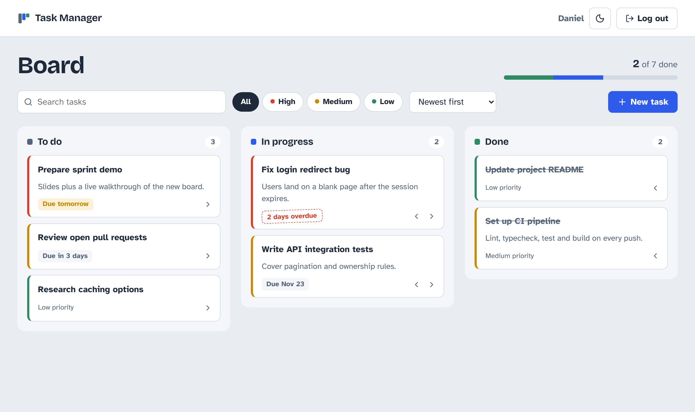
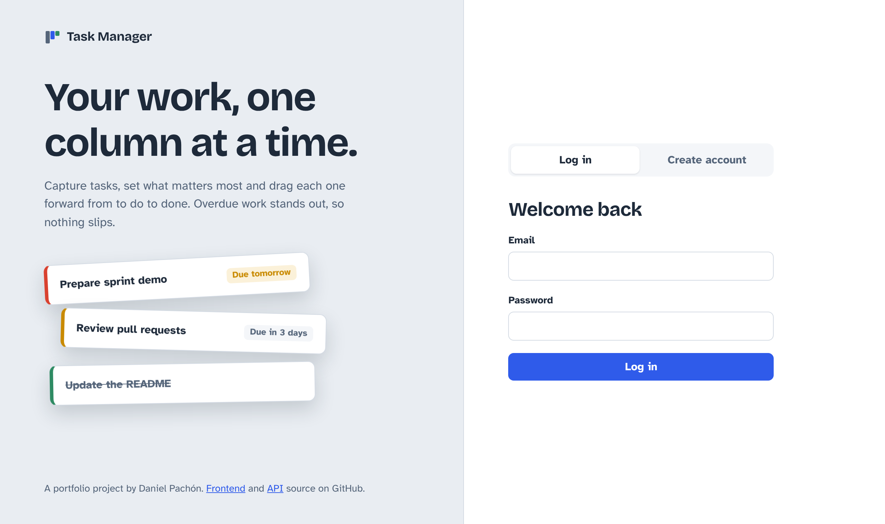
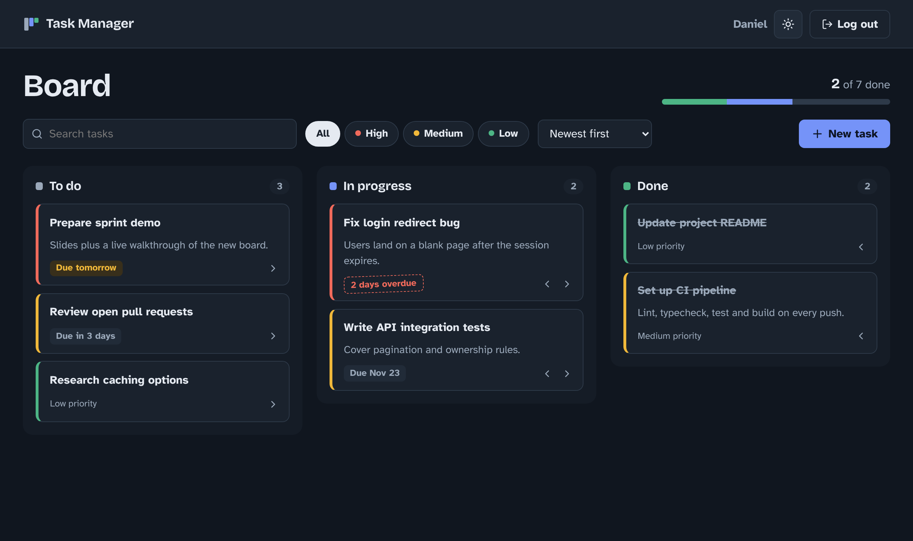

# Task Manager Web

[](https://github.com/danielPachon/task-manager-web/actions/workflows/ci.yml)


**🚀 Live demo:** [task-manager-web.onrender.com](https://task-manager-web.onrender.com)

A Kanban-style task manager built with **React, TypeScript and TanStack Query**. It is the frontend for my [Task Manager API](https://github.com/danielPachon/task-manager-api) (Node.js, Express, PostgreSQL).

> The API runs on a free tier that sleeps when idle. The first request can take up to a minute, and the app tells you when that happens.



## Features

- **Kanban board** with three columns (To do, In progress, Done). Move tasks with **drag and drop** or with the arrow buttons, which also work on touch screens and with the keyboard.
- **Optimistic updates**: moving a card is instant, and the change is rolled back if the server rejects it.
- **Search, priority filters and sorting** by creation date, due date or priority, all handled by the API.
- **Due dates that stand out**: "Due tomorrow", "Due in 3 days" or a dashed "2 days overdue" stamp.
- **Create, edit and delete** tasks in an accessible modal dialog, with a two-step delete confirmation.
- **Authentication** with JWT: register, log in, session kept across reloads and automatic logout when the token expires.
- **Server validation errors** shown next to the field they belong to.
- **Light and dark themes**, following the system setting by default.
- **Responsive** from 375 px phones to wide screens.
- **Cold-start notice** when a request takes longer than three seconds.

| Login | Dark theme |
|---|---|
|  |  |

## Tech stack

| Area | Tools |
|---|---|
| UI | React 19, TypeScript (strict), plain CSS with design tokens |
| Data | TanStack Query (caching, optimistic updates), Fetch API |
| Routing | React Router |
| Testing | Vitest, Testing Library |
| Tooling | Vite, Oxlint, GitHub Actions |
| Hosting | Render static site (Blueprint as code) |

## Architecture

```
src/
├── api/          # Typed fetch client, endpoints and API types
├── auth/         # Auth context: session storage, login, register, logout
├── hooks/        # Task queries and mutations, theme, debounce, slow-request detection
├── components/   # Board columns, task card, dialog, toolbar, header, toasts
├── pages/        # Auth page and board page
└── utils/        # Date formatting, constants and safe localStorage access
```

**Design decisions**

- **Server state lives in TanStack Query**, not in component state. Filters are part of the query key, so each combination is cached and the board updates without manual refetching.
- **One small fetch wrapper** adds the token, turns error responses into a typed `ApiError` with field details, and logs the user out on a `401`.
- **Accessibility first**: semantic landmarks, native `<dialog>`, labelled controls, visible focus, keyboard-friendly alternatives to drag and drop, and reduced motion support.
- **No UI framework**: the visual system is a small set of CSS custom properties, which keeps the bundle light and the design consistent across both themes.

## Getting started

Requirements: Node.js 20+ and a running instance of the [Task Manager API](https://github.com/danielPachon/task-manager-api).

```bash
npm install
cp .env.example .env    # point VITE_API_URL to your API
npm run dev
```

Without a `.env` file, the app uses the deployed API.

| Script | Description |
|---|---|
| `npm run dev` | Start the dev server |
| `npm run build` | Typecheck and build for production |
| `npm test` | Run the test suite |
| `npm run lint` | Lint with Oxlint |

## Testing

Tests cover the date logic, the task card interactions and the login and registration flows, including how API validation errors are displayed.

```bash
npm test
```

## License

MIT © Daniel Pachón
